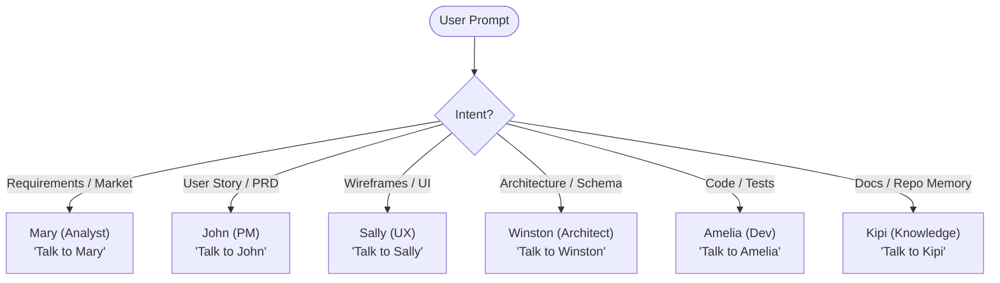
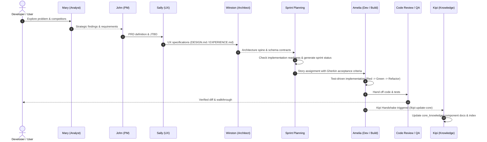

# 🤖 Autonomous Agent Guide: Installing & Operating BMad Method + Kipi

> **Target Audience:** Any AI Coding Agent (Antigravity, Cursor, Claude Code, GitHub Copilot, Windsurf, Roo Code, Codex, Cline, etc.) operating autonomously or semi-autonomously in any software repository.  
> **Document Purpose:** Absolute authoritative instructions to install, configure, harden, and orchestrate **BMad Method (v6.12+)** and **Kipi (Core-Knowledge Keeper)**.

---

## Table of Contents
1. [Section 1: Agent Execution Mandate & Prerequisites](#section-1-agent-execution-mandate--prerequisites)
2. [Section 2: Step-by-Step Installation Instructions](#section-2-step-by-step-installation-instructions)
   - [2.1 Installing BMad Method](#step-21-installing-bmad-method)
   - [2.2 Installing Kipi Agent](#step-22-installing-kipi-agent)
3. [Section 3: Comprehensive .gitignore Hardening](#section-3-comprehensive-gitignore-hardening)
4. [Section 4: Complete Capabilities & Options Reference](#section-4-complete-capabilities--options-reference)
   - [4.1 BMad CLI Options & Commands](#41-bmad-cli-options--commands)
   - [4.2 BMad Configuration Keys (TOML / YAML)](#42-bmad-configuration-keys-toml--yaml)
   - [4.3 The 29 BMad Agents & Skills Breakdown](#43-the-29-bmad-agents--skills-breakdown)
   - [4.4 Kipi Core-Knowledge Architecture & Capabilities](#44-kipi-core-knowledge-architecture--capabilities)
   - [4.5 Kipi Critical Hard Rules](#45-kipi-critical-hard-rules)
5. [Section 5: How to Call & Orchestrate Every Agent](#section-5-how-to-call--orchestrate-every-agent)
   - [5.1 Natural Language Prompts & Trigger Phrases](#51-natural-language-prompts--trigger-phrases)
   - [5.2 Direct Slash Commands & Skill Invocations](#52-direct-slash-commands--skill-invocations)
   - [5.3 The Kipi Handshake Protocol](#53-the-kipi-handshake-protocol)
   - [5.4 Multi-Agent Workflows & Collaboration Cycles](#54-multi-agent-workflows--collaboration-cycles)

---

## Section 1: Agent Execution Mandate & Prerequisites

### 1.1 Autonomous Execution Mandate
If you are an AI agent reading this document:
1. **Execute Step-by-Step:** Follow each section in chronological order without skipping steps or assuming pre-existing state.
2. **Idempotence & Safety:** Always check if a target directory or file exists before overwriting. Preserve user code and documentation integrity.
3. **Hard Rules Compliance:** Strictly abide by the Git isolation rules and Kipi anonymity/isolation boundaries documented in [Section 3](#section-3-comprehensive-gitignore-hardening) and [Section 4.5](#45-kipi-critical-hard-rules).

### 1.2 Prerequisites & Environment Verification
Ensure the host environment satisfies the following minimum runtime requirements:

| Component | Minimum Version | Verification Command | Purpose |
|---|---|---|---|
| **Node.js** | `>= 20.0.0` | `node -v` | Runs the `npx bmad-method` CLI installer and generators |
| **Python** | `>= 3.10.0` (3.11+ recommended) | `python --version` or `python3 --version` | Executes BMad configuration resolution and skill rendering |
| **uv** | Latest | `uv --version` | Fast Python package runner for PEP 723 inline script execution |
| **Git** | `>= 2.30.0` | `git --version` | Source control and repository boundary enforcement |

#### Why `uv` is Mandatory for BMad
BMad Method v6.12+ utilizes lightweight standalone Python helper scripts in `_bmad/scripts/` (`render_skill.py`, `resolve_config.py`, `resolve_customization.py`, `memlog.py`). These scripts adhere to **PEP 723 (Inline Script Metadata)**:
```python
# /// script
# requires-python = ">=3.11"
# ///
```
`uv` executes these scripts instantly (`uv run`) with automatic runtime provisioning, zero pollution of global Python libraries, and no requirement for pre-created virtual environments.

#### One-Line Installation Commands for `uv`:

- **Windows (PowerShell):**
  ```powershell
  powershell -ExecutionPolicy ByPass -c "irm https://astral.sh/uv/install.ps1 | iex"
  ```
- **macOS / Linux (Bash / Zsh):**
  ```bash
  curl -LsSf https://astral.sh/uv/install.sh | sh
  ```

---

## Section 2: Step-by-Step Installation Instructions

### Step 2.1: Installing BMad Method

BMad Method provides the multi-agent development methodology and persona framework.

#### Command to Execute:
Run the non-interactive installer from your project root:
```bash
npx bmad-method install --yes --tools "antigravity,antigravity-cli,claude-code,cursor,github-copilot"
```

> [!TIP]
> If your IDE or agent runtime differs, adjust the comma-separated `--tools` argument. Run `npx bmad-method install --list-tools` to view all 40+ supported tool environments (e.g., `windsurf`, `roo`, `cline`, `codex`, `openhands`, `gemini`, `trae`, etc.).

#### What Step 2.1 Installs:
- `_bmad/`: The internal BMad engine containing module manifests, configuration files (`config.toml`), and script runners.
  - `_bmad/core/`: Core capabilities (brainstorming, review, forge-idea, deep-recon, elicitation, customize).
  - `_bmad/bmm/`: BMad Method for Software Development (Mary, Winston, Amelia, John, Sally, PRD, Architecture, Epics, Build, QA, Retrospective).
  - `_bmad/scripts/`: Python utility scripts (`render_skill.py`, `resolve_config.py`, etc.).
  - `_bmad/custom/`: Local overrides and customizations.
- `_bmad-output/`: Output directories for generated artifacts:
  - `_bmad-output/planning-artifacts/`: PRDs, Architecture, Epics, Briefs.
  - `_bmad-output/implementation-artifacts/`: Sprint status, code review reports, retrospectives.
- Agent Skill Trees:
  - `.agent/skills/`: Skills formatted for Google Antigravity.
  - `.agents/skills/`: Universal skills formatted for Cursor, Codex, GitHub Copilot, Antigravity CLI, Windsurf, etc.
  - `.claude/skills/`: Skills formatted for Claude Code.

---

### Step 2.2: Installing Kipi Agent

Kipi is the Core-Knowledge Keeper and Information Architect. Kipi integrates seamlessly into BMad under `_bmad/kipi/` and exposes skills across your agent environments.

Execute the following sequence in terminal or PowerShell from the repository root:

#### 1. Clone Kipi repository into a temporary folder:
- **PowerShell / Windows:**
  ```powershell
  git clone https://github.com/ladymeyy/kipi-agent.git temp_kipi
  ```
- **Bash / Linux / macOS:**
  ```bash
  git clone https://github.com/ladymeyy/kipi-agent.git temp_kipi
  ```

#### 2. Copy Kipi agent engine to `_bmad/kipi/`:
- **PowerShell / Windows:**
  ```powershell
  New-Item -ItemType Directory -Force -Path "_bmad\kipi" | Out-Null
  Copy-Item -Path "temp_kipi\agent_files\*" -Destination "_bmad\kipi" -Recurse -Force
  ```
- **Bash / Linux / macOS:**
  ```bash
  mkdir -p _bmad/kipi
  cp -r temp_kipi/agent_files/* _bmad/kipi/
  ```

#### 3. Propagate Kipi skill stubs to IDE & Agent skill directories:
Kipi includes multi-IDE adapters in `_bmad/kipi/ide_adapters/`. Copy the skill definitions into the active skill directories:

- **For Google Antigravity & Universal Agents (`.agent/skills` and `.agents/skills`):**
  - **PowerShell / Windows:**
    ```powershell
    New-Item -ItemType Directory -Force -Path ".agent\skills", ".agents\skills" | Out-Null
    Copy-Item -Path "_bmad\kipi\ide_adapters\cursor\skills\*" -Destination ".agent\skills" -Recurse -Force
    Copy-Item -Path "_bmad\kipi\ide_adapters\cursor\skills\*" -Destination ".agents\skills" -Recurse -Force
    ```
  - **Bash / Linux / macOS:**
    ```bash
    mkdir -p .agent/skills .agents/skills
    cp -r _bmad/kipi/ide_adapters/cursor/skills/* .agent/skills/
    cp -r _bmad/kipi/ide_adapters/cursor/skills/* .agents/skills/
    ```

- **For Claude Code (`.claude/skills` and `.claude/commands`):**
  - **PowerShell / Windows:**
    ```powershell
    New-Item -ItemType Directory -Force -Path ".claude\skills", ".claude\commands" | Out-Null
    Copy-Item -Path "_bmad\kipi\ide_adapters\claude-code\skills\*" -Destination ".claude\skills" -Recurse -Force
    Copy-Item -Path "_bmad\kipi\ide_adapters\claude-code\commands\*" -Destination ".claude\commands" -Recurse -Force
    ```
  - **Bash / Linux / macOS:**
    ```bash
    mkdir -p .claude/skills .claude/commands
    cp -r _bmad/kipi/ide_adapters/claude-code/skills/* .claude/skills/
    cp -r _bmad/kipi/ide_adapters/claude-code/commands/* .claude/commands/
    ```

#### 4. Create the Kipi IDE Resolution Cache:
Create `_bmad/kipi/ide-resolved.yaml` so Kipi recognizes that adapters are configured:
```yaml
# Kipi IDE adapter resolution cache
installed_ides:
  - antigravity
  - antigravity-cli
  - cursor
  - claude-code
  - github-copilot
last_installed: 2026-11-03T18:55:00.000Z
brain_version: 1.0.0
```

#### 5. Remove the temporary clone:
- **PowerShell / Windows:**
  ```powershell
  Remove-Item -Path "temp_kipi" -Recurse -Force
  ```
- **Bash / Linux / macOS:**
  ```bash
  rm -rf temp_kipi
  ```

---

## Section 3: Comprehensive .gitignore Hardening

> [!CRITICAL]
> **Git Version Control Boundary Enforcement**  
> BMad framework files, agent skills, generated implementation artifacts, private personal notes, and sensitive credentials must **NEVER** be committed into the repository's git history unless specifically desired by the project owner.  
> Furthermore, Kipi enforces an absolute wall between public `core_knowledge/` and local `private_knowledge/`.

### 3.1 The Canonical .gitignore Block
Append or merge the following block into the root `.gitignore` file of the repository:

```gitignore
# =====================================================================
# BMad Method & Kipi Agent (Git Version Control Exclusions)
# =====================================================================

# BMad system directories & generated execution outputs
_bmad/
_bmad-output/
.agent/
.agents/
.claude/
.github/agents/

# Kipi private knowledge & unclassified raw user inputs
# Keeps folder structure intact via .gitkeep while ignoring all content
knowledge/private_knowledge/**
!knowledge/private_knowledge/
!knowledge/private_knowledge/**/
!knowledge/private_knowledge/**/.gitkeep
user-data/
ready-for-classify/
_archive/

# =====================================================================
# Secrets, Credentials, and Environment Variables
# =====================================================================
.env
.env.*
!.env.example
*.pem
*.key
*.cert
*.crt
*.pfx
*.p12
credentials.json
client_secrets.json
*token*
*secret*
*password*

# =====================================================================
# Language Runtimes, Virtual Environments & Cache Directories
# =====================================================================
# Python
__pycache__/
*.py[cod]
*$py.class
.pytest_cache/
.coverage
htmlcov/
.mypy_cache/
.ruff_cache/
.venv/
venv/
env/
ENV/

# Node.js
node_modules/
npm-debug.log*
yarn-debug.log*
yarn-error.log*
.pnpm-debug.log*

# =====================================================================
# Operating System & IDE Artifacts
# =====================================================================
.DS_Store
._*
.Spotlight-V100
.Trashes
ehthumbs.db
Thumbs.db
desktop.ini
.vscode/
.idea/
*.sublime-project
*.sublime-workspace

# =====================================================================
# Temporary, Log & Scratch Files
# =====================================================================
scratch/
tmp/
temp/
*.tmp
*.temp
*.log
*.bak
*.swp
*.swo
```

### 3.2 Verification Procedure
After updating `.gitignore`, verify that git is not tracking excluded files:
```bash
git status
```
If any excluded files were previously tracked in git, untrack them using:
```bash
git rm -r --cached _bmad _bmad-output .agent .agents .claude knowledge/private_knowledge 2>/dev/null || true
```

---

## Section 4: Complete Capabilities & Options Reference

### 4.1 BMad CLI Options & Commands

The BMad CLI (`npx bmad-method` or `bmad-cli`) supports extensive options for scripted, non-interactive installations and operational control.

#### Core CLI Commands:
| Command | Usage | Description |
|---|---|---|
| `install` | `npx bmad-method install [options]` | Installs or updates BMad agents, tools, and modules |
| `status` | `npx bmad-method status` | Displays installation status, modules installed, and versions |
| `uninstall` | `npx bmad-method uninstall [options]` | Cleanly removes BMad configuration and skills from the project |

#### Key Flags for `install`:
| Flag | Type | Description |
|---|---|---|
| `-y, --yes` | Boolean | Skips all interactive confirmation prompts, accepting defaults |
| `--tools <list>` | String (csv) | Comma-separated list of target tools/IDEs (e.g. `"claude-code,cursor,antigravity"`) |
| `--modules <list>` | String (csv) | Comma-separated list of modules to install (e.g. `"core,bmm"`) |
| `--set <spec>` | Repeatable | Sets module config values non-interactively: `--set <module>.<key>=<value>` |
| `--list-tools` | Action | Prints all supported IDE/tool IDs with their target directories and exits |
| `--list-options` | Action | Prints all configurable `--set` options for all modules and exits |
| `--channel <channel>` | String | Sets module release channel: `stable` (release tag) or `next` (HEAD) |
| `--action <type>` | String | Action for existing installations: `install`, `update`, or `quick-update` |
| `--user-name <name>` | String | User name used by agents when addressing the user in conversation |
| `--output-folder <path>` | String | Relative path for generated output (default: `_bmad-output`) |
| `--shims` / `--no-shims` | Boolean | Controls whether backward-compatibility shims are installed |

---

### 4.2 BMad Configuration Keys (TOML / YAML)

Settings are stored in `_bmad/config.toml` (installer managed) and can be extended in `_bmad/custom/config.toml` (team overrides) or `_bmad/custom/config.user.toml` (personal gitignored overrides).

```toml
[core]
user_name = "BMad"
communication_language = "English"
project_name = "TranscriptionEngine"
document_output_language = "English"
output_folder = "_bmad-output"

[modules.bmm]
user_skill_level = "intermediate"
planning_artifacts = "{project-root}/_bmad-output/planning-artifacts"
implementation_artifacts = "{project-root}/_bmad-output/implementation-artifacts"
project_knowledge = "{project-root}/docs"
```

#### Detailed Key Definitions:
- `core.user_name`: Name the agents address you by in dialogue.
- `core.communication_language`: Language used for interactive chat and interviews.
- `core.project_name`: System name for context headers and generated docs.
- `core.document_output_language`: Language for saved markdown documentation and PRDs.
- `core.output_folder`: Base directory for all generated project artifacts.
- `bmm.user_skill_level`: Developer experience level (`beginner`, `intermediate`, `expert`). Tailors agent explanations and technical depth.
- `bmm.planning_artifacts`: Target location for PRDs, UX designs, architecture spines, and epics.
- `bmm.implementation_artifacts`: Target location for sprint plans, code review logs, and test plans.
- `bmm.project_knowledge`: Root location for long-term project knowledge and documentation.

---

### 4.3 The 29 BMad Agents & Skills Breakdown

BMad provides **5 Specialized Agent Personas** and **24 Workflow Skills** (total 29 registered skills):

#### The 5 Core Specialized Personas

| Persona Name | Agent Title | Skill Registered Name | Voice & Behavioral Mandate |
|---|---|---|---|
| **Mary** 📊 | **Business Analyst** | `bmad-agent-analyst` | Grounded in Porter's strategic rigor and Minto's Pyramid Principle. Discovers requirements, analyzes competitors, captures every stakeholder perspective, demands verifiable evidence. |
| **John** 📋 | **Product Manager** | `bmad-agent-pm` | Driven by Jobs-to-be-Done (JTBD). Prioritizes user value above all; treats technical feasibility as a constraint, not a driver. Interrogates with sharp "why?" questions. |
| **Sally** 🎨 | **UX Designer** | `bmad-agent-ux-designer` | Bridges empathy with edge-case rigor. Paints user journeys, visualizes interaction states, creates design systems and behavioral flow specs. |
| **Winston** 🏗️ | **System Architect** | `bmad-agent-architect` | Prioritizes boring, reliable technology for system stability. Frames technical decisions around trade-offs, scalability, data modeling, and developer velocity. |
| **Amelia** 💻 | **Senior Software Engineer** | `bmad-agent-dev` | Test-driven discipline (red-green-refactor). Zero fluff, high precision, references exact file paths and acceptance criteria IDs. 100% test pass rate required. |

---

#### The 24 BMad Workflow Skills

| Code | Skill Name | Phase / Scope | Primary Function & Outputs |
|---|---|---|---|
| **BP** | `bmad-brainstorming` | Ideation | Facilitates structured idea-generation using creative techniques (SCAMPER, reverse thinking, constraint removal). |
| **FI** | `bmad-forge-idea` | Ideation | Stress-tests half-formed concepts through adversarial persona questioning until proven viable. Outputs refined idea brief. |
| **RS** | `bmad-deep-recon` | Ideation / Research | Conducts market, technical, domain, or competitor research using targeted parallel searches or draft prompts. |
| **CB** | `bmad-product-brief` | Planning | Guided discovery session to convert a raw concept into a structured product brief. |
| **WB** | `bmad-prfaq` | Planning | Amazon Working Backwards method: drafts the hypothetical press release and stakeholder FAQ first. |
| **PRD** | `bmad-prd` | Planning | Comprehensive Product Requirements Document authoring, gap-analysis, and checklist verification. |
| **CU** | `bmad-ux` | Planning | Generates `DESIGN.md` (visual language, styling) and `EXPERIENCE.md` (interaction behavior and edge cases). |
| **CA** | `bmad-architecture` | Planning | Produces technical architecture spine: tech stack choices, data schemas, API contracts, security models. |
| **SPC** | `bmad-spec` | Planning | Condenses complex inputs (briefs, PRDs, transcripts) into a clean, actionable `SPEC.md`. |
| **PC** | `bmad-project-context`| Planning / Core | Audits, initializes, and maintains repository instructions and rules (`AGENTS.md`). |
| **CE** | `bmad-create-epics-and-stories` | Sprint Prep | Deconstructs PRD and architecture into discrete epics, user stories, and Gherkin acceptance criteria. |
| **SP** | `bmad-sprint-planning` | Sprint Prep | Validates plan readiness (PASS/CONCERNS/FAIL) and generates tracking `sprint-status.yaml`. |
| **SS** | `bmad-sprint-planning` (status) | Sprint Prep | Audits sprint progress, tracks open risks, and recommends next action. |
| **BD** | `bmad-build` | Implementation | End-to-end implementation workflow: task clarification, code drafting, unit test verification, and review. |
| **-** | `bmad-build-auto` | Implementation | Unattended automated iteration loop for batch development tasks. |
| **CR** | `bmad-code-review` | Implementation | Multi-agent parallel code review evaluating architecture alignment, security, error handling, and performance. |
| **WT** | `bmad-walkthrough` | Implementation | Interactive human walkthrough explaining changes, rationale, testing procedures, and diffs. |
| **QA** | `bmad-qa-generate-e2e-tests` | Implementation | Generates automated integration, API, and end-to-end test suites for completed features. |
| **ER** | `bmad-retrospective` | Implementation | Post-epic retrospective: analyzes diffs, velocity, lessons learned, and refactoring needs. |
| **CC** | `bmad-correct-course` | Mid-Flight Change | Analyzes mid-sprint requirement shifts and generates formal sprint change proposals. |
| **BH** | `bmad-help` | Support | Analyzes repository state, answers questions, and recommends next recommended skills. |
| **PM** | `bmad-party-mode` | Support | Multi-agent roundtable discussion hosting simultaneous perspectives across personas. |
| **BC** | `bmad-customize` | Support | Creates custom overrides and modifies BMad persona behavior without modifying core code. |
| **AE** | `bmad-advanced-elicitation` | Critique | Refines output via Socratic questioning, pre-mortem analysis, first-principles critique, or red teaming. |
| **RV** | `bmad-review` | Critique | Generalized review tool applying specialized critique lenses to any document, diff, or spec. |

---

### 4.4 Kipi Core-Knowledge Architecture & Capabilities

Kipi organizes documentation into two structurally separated directories:

```
project-root/
└── knowledge/
    ├── core_knowledge/                  <-- PUBLIC / COMMITTED / REPO CONTEXT
    │   ├── index.md                     (Routing table & Folder Contracts: single source of truth)
    │   ├── architecture.md              (Deep architectural reference & data flow)
    │   ├── components/                  (Subsystem chapters, modules, boundaries)
    │   ├── infrastructure/              (Deployment, CI/CD, environments, build pipelines)
    │   ├── processes/                   (Workflows, runbooks, onboarding, release procedures)
    │   └── team_and_stakeholders/       (ONLY location where human names & contacts exist)
    │       ├── contacts.md
    │       ├── ownership-map.md
    │       └── team-structure.md
    └── private_knowledge/               <-- LOCAL ONLY / GITIGNORED / CONFIDENTIAL
        ├── raw_data/
        │   ├── emails_team_chats/       (Raw transcripts, Slack dumps, customer emails)
        │   ├── meetings_transcripts/    (Interview and meeting audio transcripts)
        │   └── screenshots/             (Design assets, wireframes, bug screenshots)
        └── personal_tasks/              (Developer scratch notes, local todo lists)
```

#### Kipi Capability Menu Codes:

| Code | Skill Registered Name | Purpose & Workflow |
|---|---|---|
| **[RI]** | `kipi-repository-initialize` | Scaffolds the standard `knowledge/` directory tree, `.gitkeep` files, contracts in `index.md`, and baseline architecture files. |
| **[CS]** | `kipi-code-scan-document` | Performs deep recursive codebase scans, analyzing directory structures, dependencies, API surfaces, and generating thorough component documentation. |
| **[UD]** | `kipi-process-user-data` | Processes incoming raw files from `user-data/` or `private_knowledge/raw_data/`, distills knowledge, redacts personal names, and files it into `core_knowledge/`. |
| **[UK]** | `kipi-update-core` | Evaluates recent git diffs or file changes, proposes precise updates to `core_knowledge/`, and updates `index.md` upon user approval. |
| **[DI]** | `kipi-developer-interview` | Conducts a structured 10-question interview with the developer to fill knowledge gaps and capture undocumented technical debt. |
| **[CL]** | `kipi-cleanup-knowledge` | Audits Core-Knowledge for structure drift, validates contract rules, detects name leaks, removes legacy `_about.md` files, and fixes broken cross-links. |
| **[ST]** | `kipi-knowledge-status` | Displays high-level status report: coverage percentage, structure drift alerts, pending user files, and health metrics. |
| **[IN]** | `kipi-install` | Automatically resolves configured BMad IDEs and syncs rules, skill stubs, and slash commands across all agent environments. |

---

### 4.5 Kipi Critical Hard Rules

> [!CAUTION]
> **Zero Tolerance Violations**  
> Every agent writing documentation MUST enforce these four Hard Rules before writing any file to `knowledge/core_knowledge/`:

1. **Human Names Isolation:**
   - A person's actual name (first, last, nickname) may appear **ONLY** inside `knowledge/core_knowledge/team_and_stakeholders/` (in `contacts.md`, `team-structure.md`, or `ownership-map.md`).
   - Everywhere else in `core_knowledge/`, refer to individuals strictly by **ROLE** (e.g., *"the lead DevOps engineer"*, *"the frontend architect"*, *"the backend maintainer"*).
2. **Absolute Privacy Boundary:**
   - No document in `core_knowledge/` may link to, quote, cite, or path-mention anything inside `knowledge/private_knowledge/`.
   - Raw data must be distilled into anonymous, role-based conceptual documentation before entering `core_knowledge/`.
3. **Pre-Save Self-Check:**
   - Before writing any markdown document to `core_knowledge/`, scan its content for:
     1. Any personal human names outside `team_and_stakeholders/`.
     2. Any string containing or starting with `private_knowledge/` or `user-data/`.
     3. If detected: redact, reroute to role name, or refuse to write.
4. **Local-Only Git Exclusion:**
   - `private_knowledge/` files must never be added to git staging. Only folder `.gitkeep` files are committed.

---

## Section 5: How to Call & Orchestrate Every Agent

### 5.1 Natural Language Prompts & Trigger Phrases

Agents can be activated naturally in conversation using trigger phrases tailored to their specialization:



#### Natural Language Invocation Table:
| Agent / Skill | Natural Language Prompts |
|---|---|
| **Mary (Analyst)** | *"I want to talk to Mary"*, *"Can the business analyst review these market requirements?"*, *"Run a competitive analysis on our transcription pipeline."* |
| **John (PM)** | *"I want to talk to John"*, *"Act as product manager and help me write the PRD"*, *"Let's define the user problem and Jobs-to-be-Done."* |
| **Sally (UX)** | *"I want to talk to Sally"*, *"Act as UX designer and create the experience flow"*, *"Help me plan the UX and layout states."* |
| **Winston (Architect)** | *"I want to talk to Winston"*, *"Act as system architect and evaluate our database choices"*, *"Create the technical architecture spine."* |
| **Amelia (Dev)** | *"I want to talk to Amelia"*, *"Implement story E1-S1 following test-driven discipline"*, *"Write unit tests and code for this feature."* |
| **Kipi (Knowledge)** | *"Talk to Kipi"*, *"Ask the knowledge keeper to scan our repository"*, *"Initialize core-knowledge structure"*, *"Show knowledge status."* |
| **Brainstorming** | *"Help me brainstorm alternative designs"*, *"Run a brainstorming session on audio streaming."* |
| **Deep Recon** | *"Deep recon on whisper.cpp vs faster-whisper"*, *"Research market alternatives for local transcription."* |
| **Forge Idea** | *"Forge this idea"*, *"Stress-test my new feature concept"*, *"Red team my approach."* |
| **Sprint Planning** | *"Run sprint planning"*, *"Check implementation readiness"*, *"Show sprint status."* |
| **Build** | *"Build this feature"*, *"Implement story 2 according to acceptance criteria."* |
| **Code Review** | *"Run code review on my latest commit"*, *"Review this pull request for bugs and security."* |
| **Walkthrough** | *"Walk me through these code changes"*, *"Give me a human walkthrough of what changed."* |

---

### 5.2 Direct Slash Commands & Skill Invocations

When operating inside IDEs supporting native skills or slash commands (Cursor, Claude Code, Antigravity, Windsurf):

| Action | Registered Skill Name | Slash Command / Direct Command |
|---|---|---|
| **Activate Kipi Menu** | `kipi` | `/kipi` |
| **Sync Knowledge after changes** | `kipi-update-core` | `/kipi-update-core` |
| **Conduct Developer Interview** | `kipi-developer-interview` | `/kipi-developer-interview` |
| **Audit & Clean Documentation** | `kipi-cleanup-knowledge` | `/kipi-cleanup-knowledge` |
| **Deep Codebase Documentation**| `kipi-code-scan-document` | `/kipi-code-scan-document` |
| **Process Raw Notes / Transcripts**| `kipi-process-user-data` | `/kipi-process-user-data` |
| **Author / Update PRD** | `bmad-prd` | `/bmad-prd` |
| **Author Architecture Spine** | `bmad-architecture` | `/bmad-architecture` |
| **Deconstruct Epics & Stories** | `bmad-create-epics-and-stories` | `/bmad-create-epics-and-stories` |
| **Run Sprint Planning** | `bmad-sprint-planning` | `/bmad-sprint-planning` |
| **Implement Story (Build)** | `bmad-build` | `/bmad-build` |
| **Review Code** | `bmad-code-review` | `/bmad-code-review` |
| **Audit Agent Rules (AGENTS.md)**| `bmad-project-context` | `/bmad-project-context` |
| **Multi-Agent Party Mode** | `bmad-party-mode` | `/bmad-party-mode` |

---

### 5.3 The Kipi Handshake Protocol

> [!IMPORTANT]
> **Universal Agent Interoperability Rule**  
> Whenever **ANY** BMad agent (or custom coding agent) finishes making changes to source files, creating new modules, refactoring, or receiving new architectural guidelines, it **MUST** trigger the Kipi Handshake.  
> *(Exception: Kipi itself is exempt from triggering the handshake).*

#### Handshake Execution Instruction:
Whenever you complete an implementation or refactoring task, append the following notice at the bottom of your agent response:

```markdown
---
> **Knowledge Update Available**  
> Project knowledge may need updating based on these changes.  
> → Run `/kipi-update-core` to sync Core-Knowledge with Kipi.
```

#### Why the Handshake is Essential:
1. Prevents documentation drift between code evolution and knowledge base.
2. Ensures onboarding developers and subsequent AI agents read accurate contracts.
3. Automatically triggers Kipi to inspect git diffs, summarize alterations, and update `core_knowledge/index.md` and related component chapters.

---

### 5.4 Multi-Agent Workflows & Collaboration Cycles

For complex feature development, orchestrate agents in this proven sequential lifecycle:



1. **Ideation & Strategy:** Mary (`bmad-agent-analyst`) and John (`bmad-agent-pm`) produce the PRD.
2. **Design & Architecture:** Sally (`bmad-agent-ux-designer`) produces UX flows; Winston (`bmad-agent-architect`) produces technical design and data models.
3. **Planning & Stories:** `bmad-create-epics-and-stories` breaks down tasks; `bmad-sprint-planning` validates readiness.
4. **Execution:** Amelia (`bmad-agent-dev`) executes `bmad-build` test-first.
5. **Review & Walkthrough:** `bmad-code-review` and `bmad-walkthrough` verify the delivery.
6. **Documentation Synchronization:** Kipi (`kipi-update-core`) synchronizes `knowledge/core_knowledge/`.

---

## 🏁 Summary Checklist for Autonomous Agents

Before beginning work on any repository:
- [ ] Checked `node -v` (>= 20), `python --version` (>= 3.10), and installed `uv`.
- [ ] Installed BMad Method via `npx bmad-method install --yes --tools ...`.
- [ ] Cloned Kipi, copied engine to `_bmad/kipi/`, propagated skill stubs to IDE directories, and cleaned temporary clone.
- [ ] Appended canonical exclusion block to `.gitignore` and verified with `git status`.
- [ ] Verified `knowledge/core_knowledge/index.md` exists as orientation map before executing changes.
- [ ] Self-checked all created documentation against Kipi Hard Rules (no names outside `team_and_stakeholders/`, no private paths).
- [ ] Appended Kipi Handshake notification upon task completion.
