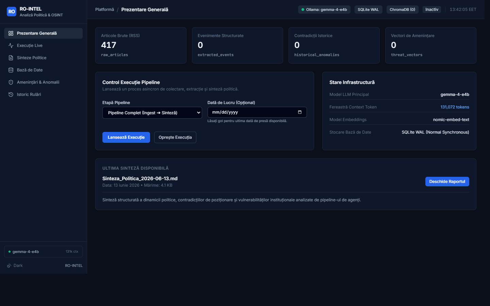
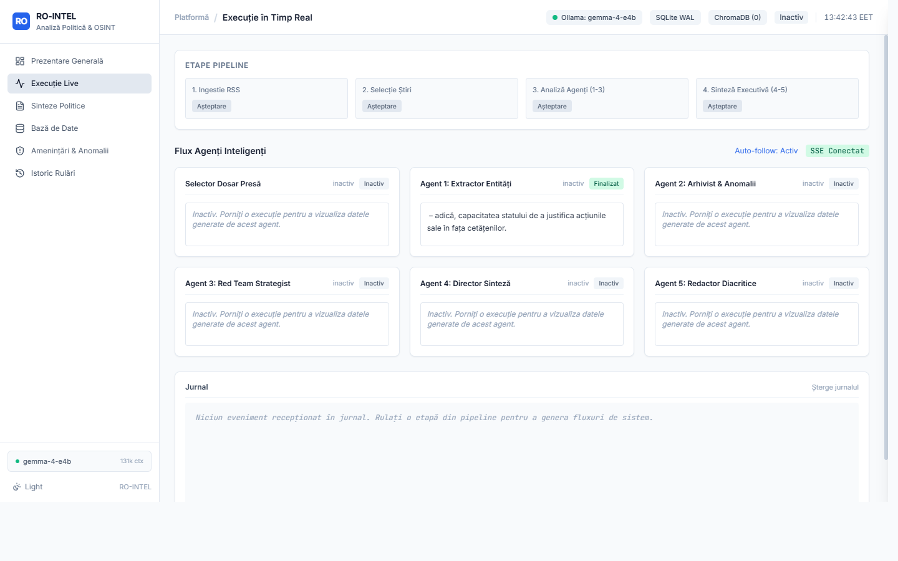
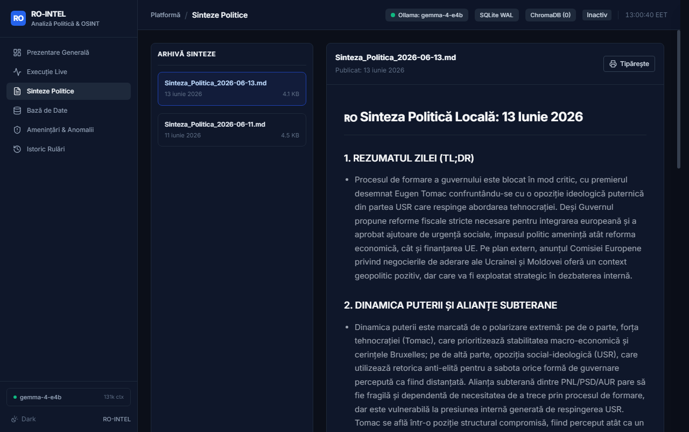
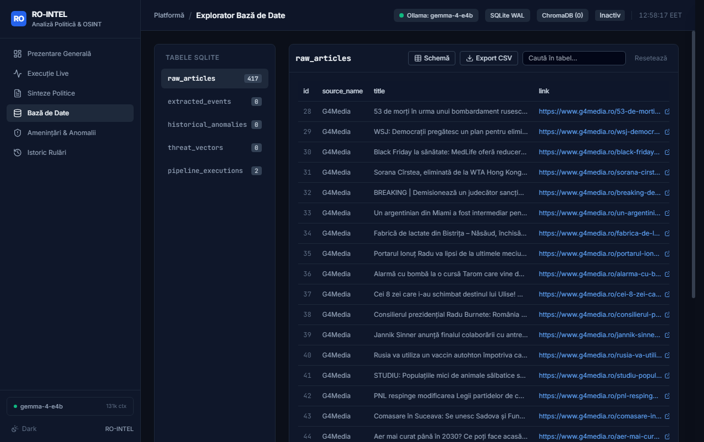

# 🇷🇴 Romanian OSINT Political Intelligence System (RO-INTEL)

[](https://python.org)
[](https://astral.sh/uv)
[](https://fastapi.tiangolo.com)
[-success.svg?logo=pytest&logoColor=white)](#automated-testing--quality-gates)
[](https://ollama.com)
[](#key-architectural-invariants)
[](#storage--memory-architecture)
[](#storage--memory-architecture)
[](#)

> **A sovereign, local-first automated geopolitical intelligence analysis platform for Romanian national monitoring.**  
> Continuously ingests Romanian news feeds, eliminates media noise via a 5-pillar strategic taxonomy, models opposition threats and political flip-flops through 6 autonomous agents, and streams executive daily intelligence briefings to a real-time defense dashboard.

---

## Table of Contents

- [Executive Overview](#executive-overview)
- [Key Features](#key-features)
- [Visual Showcase](#visual-showcase)
- [System Architecture & Data Flow](#system-architecture--data-flow)
- [The 6-Agent Reasoning Core](#the-6-agent-reasoning-core)
- [📚 Core-Knowledge Documentation Linktree](#-core-knowledge-documentation-linktree)
- [Quickstart Guide](#quickstart-guide)
- [CLI Operations & Running Stages](#cli-operations--running-stages)
- [Automated Testing & Quality Gates](#automated-testing--quality-gates)
- [Key Architectural Invariants](#key-architectural-invariants)
- [Project Governance & Team Roles](#project-governance--team-roles)

---

## Executive Overview

RO-INTEL is an end-to-end, privacy-hardened Open Source Intelligence (OSINT) platform engineered to monitor, structure, and forecast political, economic, and institutional developments in Romania.

Traditional media monitoring relies on superficial keyword clipping or expensive third-party cloud APIs that compromise data sovereignty. RO-INTEL is **100% local-first**: all web scraping, text extraction, named entity resolution, historical contradiction analysis, adversarial threat modeling, vector embeddings, and executive synthesis execute entirely on-premises using local Ollama model instances and embedded databases.

```
RSS Feeds (7 Outlets) ──> Regex Noise Filter ──> 5-Pillar Taxonomy Scoring
                                                        │
                                                        ▼
                                             NewsSelector (Top 10)
                                                        │
                                                        ▼
Press Dossier ──> Agent 1 (Entity Extractor) ──> Agent 2 (Archivist & Flip-Flop)
                                                        │
                                                        ▼
Executive Briefing <── Agent 5 (Copyeditor) <── Agent 4 (Director) <── Agent 3 (Red Team)
        │
        ▼
Real-Time Web Dashboard (FastAPI / SSE Stream / D3.js Graph / DB Viewer)
```

---

## Key Features

- **Automated Multi-Feed Ingestion:** Concurrently ingests from 7 major Romanian media outlets (G4Media, HotNews, Digi24, ActiveNews, B1TV, Agerpres, Mediafax) with HTTP connection pooling, retry policies, and resilient DOM parsing.
- **5-Pillar Strategic Taxonomy:** Weighted classification model (Domestic Politics, Macroeconomy, National Security, Justice, Critical Infrastructure) paired with strict negative noise filters that discard sports, reality TV, weather, and trivial accidents.
- **Canonical Romanian Entity Resolution:** Standardizes political titles, colloquialisms, and media variants (e.g., mapping `"premierul ciolacu"` $\to$ `"Marcel Ciolacu"`) across major leaders, parties (PSD, PNL, USR, AUR, UDMR), and institutions (DNA, CCR, CSM, Guvern).
- **6 Autonomous Specialized Agents:** Sequential analytical ensemble covering curation, structured extraction, historical cross-referencing, adversarial red teaming, executive synthesis, and diacritics copyediting.
- **Deterministic Deduplication:** Generates unique SHA-256 hashes across canonical actors, actions, and verbatim quotes to prevent duplicate entries in SQLite and ChromaDB.
- **Real-Time Executive Dashboard:** Asynchronous, non-blocking FastAPI backend serving a dark-mode defense UI (`#0b0f19`), live Server-Sent Events (SSE) token and reasoning streams, full read-only database viewer with CSV export, and D3.js force-directed Connected Papers relational graph.
- **Guaranteed Context Window (`131,072` Tokens):** Hard-coded parameter ensuring comprehensive daily press dossiers and multi-turn historical contexts are never truncated.

---

## Visual Showcase

The executive web dashboard provides real-time situational awareness and deep data audit tools:

### 1. Operations Overview Dashboard
*High-level intelligence metrics, system counters, rapid action triggers, and operational status.*


---

### 2. Live SSE Execution & Reasoning Stream
*Real-time token streaming with live progress bar and dedicated collapsible LLM thinking drawer.*


---

### 3. Executive Political Briefings
*Synthesized daily briefings featuring TL;DR, covert power dynamics, 5 predictions with confidence scores, and printable layout.*


---

### 4. Integrated Database Viewer & CSV Export
*Full read-only SQLite inspection tool with parameterized search, date range filters, pagination, and one-click CSV download.*


---

## System Architecture & Data Flow

The platform is strictly organized into decoupled, modular packages within `src/`:

```mermaid
flowchart LR
    subgraph Ingestion ["1. Ingestion Tier"]
        RSS["Romanian RSS Feeds"] --> Scraper["RSSScraper (urllib3)"]
        Scraper --> DateNorm["Date Normalization (Europe/Bucharest)"]
        DateNorm --> SQLiteRaw[("SQLite: raw_articles")]
    end

    subgraph Triage ["2. Triage & Selection"]
        SQLiteRaw --> NoiseFilter["Regex Noise Elimination"]
        NoiseFilter --> Taxonomy["5-Pillar Scoring"]
        Taxonomy --> Selector["NewsSelector (LLM)"]
        Selector --> DeepScrape["Full-Text Scraper"]
        DeepScrape --> Dossier["Press Dossier (dossier_for_agent_1.txt)"]
    end

    subgraph Reasoning ["3. Multi-Agent Reasoning"]
        Dossier --> Agent1["Agent 1: Extractor"]
        Agent1 --> SQLiteEvents[("SQLite: extracted_events")]
        Agent1 --> Chroma[("ChromaDB Vector Store")]
        
        Agent1 --> Agent2["Agent 2: Archivist"]
        Chroma -.->|Semantic Pre-fetch| Agent2
        Agent2 --> SQLiteAnom[("SQLite: historical_anomalies")]
        
        Agent1 & Agent2 --> Agent3["Agent 3: Red Team"]
        Agent3 --> SQLiteThreats[("SQLite: threat_vectors")]
        
        Agent1 & Agent2 & Agent3 --> Agent4["Agent 4: Director"]
        Agent4 --> Agent5["Agent 5: Copyeditor"]
        Agent5 --> Report["reports/Sinteza_Politica_YYYY-MM-DD.md"]
    end

    subgraph UI ["4. UI & Streaming Layer"]
        Reasoning -.->|Tokens & Thinking| EventBus["Event Bus Ring Buffer"]
        EventBus --> SSEStream["FastAPI SSE (/api/stream)"]
        SSEStream --> WebUI["Executive Web Dashboard"]
    end
```



---

## The 6-Agent Reasoning Core

| Agent | Module | Role & Core Analytical Function | Output Artifact |
|---|---|---|---|
| **NewsSelector** | `src/agents/selector.py` | Scores candidate articles, selects top 10 national developments, and deep scrapes full text into a dense summary dossier. | `dossier_for_agent_1.txt` |
| **Agent 1: Extractor** | `src/agents/agent_extractor.py` | Extracts structured political maneuvers, verbatim Romanian quotes, resolves canonical identities, and computes SHA-256 event hashes. | `ExtractedEventsContainer` $\to$ SQLite |
| **Agent 2: Archivist** | `src/agents/agent_archivist.py` | Performs two-phase vector search (ChromaDB + SQLite) to detect policy reversals and scores contradictions on a 0.0 to 1.0 scale. | `HistoricalAnomaliesContainer` $\to$ SQLite |
| **Agent 3: Red Team** | `src/agents/agent_red_team.py` | Hostile political strategist modeling systemic vulnerabilities, opposition weaponization vectors, and parasitic narrative framing. | `ThreatVectorsContainer` $\to$ SQLite |
| **Agent 4: Director** | `src/agents/agent_director.py` | Synthesizes an executive Romanian intelligence briefing: TL;DR, power dynamics, crisis exploitation, exactly 5 predictions with confidence scores. | Raw Romanian Markdown |
| **Agent 5: Copyeditor** | `src/agents/agent_copyeditor.py` | Proofreads Romanian grammar, normalizes diacritics (`ă`, `â`, `î`, `ș`, `ț`), and saves the final report artifact. | `reports/Sinteza_Politica_*.md` |

---

## 📚 Core-Knowledge Documentation Linktree

The repository maintains an authoritative, comprehensive Core-Knowledge documentation tree in `knowledge/core_knowledge/`:

### 🗺️ Index & Architecture
- [**Core-Knowledge Index (`index.md`)**](knowledge/core_knowledge/index.md) — Master routing table, domain glossary, coverage metrics, and strict Folder Contracts.
- [**System Architecture Spine (`architecture.md`)**](knowledge/core_knowledge/architecture.md) — Comprehensive technical design, layer boundaries, concurrency models, and verification metrics.

### 🧩 Subsystem Components (`knowledge/core_knowledge/components/`)
- [**Agents Architecture (`agents.md`)**](knowledge/core_knowledge/components/agents.md) — Detailed breakdown of all 6 agents: Selector, Extractor, Archivist, Red Team, Director, and Copyeditor.
- [**Classification & Taxonomy (`classification.md`)**](knowledge/core_knowledge/components/classification.md) — 5-pillar strategic taxonomy, regex noise filters, and canonical entity resolution.
- [**Scrapers & Text Extraction (`scrapers.md`)**](knowledge/core_knowledge/components/scrapers.md) — Concurrent RSS scraper, HTTP connection pooling, DOM extractor, and Romanian date parsing.
- [**Storage & Memory Architecture (`storage.md`)**](knowledge/core_knowledge/components/storage.md) — SQLite WAL mode, schema design, event hash deduplication, and ChromaDB vector store.
- [**Master Pipeline & Event Bus (`orchestrator.md`)**](knowledge/core_knowledge/components/orchestrator.md) — MasterPipeline execution, state machine, cooperative cancellation, and ring buffer.
- [**Executive Web UI & Live Stream (`ui.md`)**](knowledge/core_knowledge/components/ui.md) — FastAPI backend, SSE streaming broker, dark-mode dashboard, DB viewer, and D3.js graph.
- [**LLM Client & Inference Engine (`llm-client.md`)**](knowledge/core_knowledge/components/llm-client.md) — Ollama wrapper, 131,072 context window guarantee, thinking token stream, structured Pydantic JSON.

### ⚙️ Infrastructure & Operations (`knowledge/core_knowledge/infrastructure/`)
- [**Environment & Dependencies (`environment-and-dependencies.md`)**](knowledge/core_knowledge/infrastructure/environment-and-dependencies.md) — Python 3.10+, uv runner, local Ollama models (`gemma-4-e4b`, `nomic-embed-text`), SQLite, ChromaDB.
- [**Testing Strategy & Quality Gates (`testing-strategy.md`)**](knowledge/core_knowledge/infrastructure/testing-strategy.md) — Automated pytest suite: 77 unit & integration tests, fast regression testing (< 4s), 100% pass rate.
- [**Deployment & Operations (`deployment.md`)**](knowledge/core_knowledge/infrastructure/deployment.md) — Local-first deployment, operational CLI flags, background worker architecture, console safety.

### 🔄 Operational Processes (`knowledge/core_knowledge/processes/`)
- [**Intelligence Pipeline Execution Flow (`intelligence-pipeline-flow.md`)**](knowledge/core_knowledge/processes/intelligence-pipeline-flow.md) — Step-by-step 8-stage lifecycle from RSS ingestion to SSE streaming.
- [**Release & Versioning Standards (`release-and-versioning.md`)**](knowledge/core_knowledge/processes/release-and-versioning.md) — Branching model (`dev` $\to$ `main`), 4 automated quality gates, conventional commits, SemVer.
- [**Operator's Manual & Runbook (`operator-guide.md`)**](knowledge/core_knowledge/processes/operator-guide.md) — User manual: CLI commands, dashboard navigation, report analysis, DB search/export, system purge.

### 👥 Team & Stakeholders (`knowledge/core_knowledge/team_and_stakeholders/`)
- [**Ownership Map (`ownership-map.md`)**](knowledge/core_knowledge/team_and_stakeholders/ownership-map.md) — Role-based asset ownership matrix across all subsystems.
- [**Contact Registry (`contacts.md`)**](knowledge/core_knowledge/team_and_stakeholders/contacts.md) — Project maintainer contact information.
- [**Team Structure (`team-structure.md`)**](knowledge/core_knowledge/team_and_stakeholders/team-structure.md) — Structural organization and functional areas of responsibility.

---

## Quickstart Guide

### Prerequisites
- **Python:** `>= 3.10, < 3.13`
- **uv:** Latest ([Install uv](https://docs.astral.sh/uv/getting-started/installation/))
- **Ollama:** Running locally ([Download Ollama](https://ollama.com))

### 1. Clone & Install Dependencies
```bash
git clone <repository_url>
cd OSINT

# Install dependencies into .venv instantly with uv
uv sync
```

### 2. Prepare Local Ollama Models
Ensure Ollama is running and pull the required models:
```bash
ollama serve
ollama pull gemma-4-e4b
ollama pull nomic-embed-text
```

### 3. Configure Environment Variables
Copy the template configuration file:
```bash
cp .env.example .env
```
Default `.env` configuration:
```ini
OLLAMA_BASE_URL=http://localhost:11434
OLLAMA_MODEL=gemma-4-e4b
OLLAMA_EMBED_MODEL=nomic-embed-text
NUM_CTX=131072
TEMPERATURE=0.0
TOP_P=0.1
DB_PATH=political_intel.db
CHROMA_PATH=chroma_db
REQUEST_TIMEOUT=15
MAX_SELECTED_ARTICLES=10
```

### 4. Verify System with Test Suite
```bash
uv run pytest
```
*Expected: 77 passed in ~3.05s (100% pass rate).*

---

## CLI Operations & Running Stages

The unified CLI entrypoint is [`main.py`](file:///d:/OSINT/main.py):

### Launch Interactive Web Dashboard
```bash
python main.py --ui --port 8000
```
Open `http://127.0.0.1:8000` in your browser.

### Headless Pipeline Invocations
```bash
# Execute complete automated pipeline for today
python main.py --stage all

# Execute complete pipeline for a specific date
python main.py --stage all --date 2026-11-06

# Execute individual stages
python main.py --stage ingest
python main.py --stage select --date 2026-11-06
python main.py --stage agents --dossier dossier_for_agent_1.txt
python main.py --stage synthesize --date 2026-11-06
```

### Supported CLI Flags

| Flag | Values | Default | Purpose |
|---|---|---|---|
| `--stage` | `all`, `ingest`, `select`, `agents`, `synthesize` | `all` | Pipeline stage to execute |
| `--date` | `YYYY-MM-DD` | `None` (today) | Publication date in `Europe/Bucharest` |
| `--dossier` | File path | `dossier_for_agent_1.txt` | Path to press summary dossier |
| `--log-level` | `DEBUG`, `INFO`, `WARNING`, `ERROR` | `INFO` | Console output verbosity |
| `--ui` | Flag | `False` | Launches interactive web dashboard |
| `--host` | IP address | `127.0.0.1` | Dashboard web server host |
| `--port` | Port number | `8000` | Dashboard web server port |
| `--reload` | Flag | `False` | Enables auto-reload for development |

---

## Automated Testing & Quality Gates

The repository includes **77 automated unit and integration tests** executing via `pytest`:

```bash
# Run complete test suite
uv run pytest

# Run unit tests only
uv run pytest tests/unit/

# Run integration tests only
uv run pytest tests/integration/
```

### Quality Invariants Enforced in Tests
- **Multi-Format Date Resolution:** ISO-8601, RFC 822, feedparser `struct_time`, European `DD/MM/YYYY`, Romanian month names (`"14 Iunie 2026"`), and timezone boundary normalization (`tests/unit/test_date_parsing.py`, `tests/unit/test_date_regression.py`).
- **Date Negative Invariant:** Verifies that missing or corrupt publication dates return `None` and **never** silently default to today's date (`tests/unit/test_date_regression.py`).
- **Context Window Preservation:** Verifies that `num_ctx = 131072` is sent in every inference call (`tests/unit/test_llm_client.py`).
- **Relational Integrity & WAL Concurrency:** Verifies SQLite WAL mode, foreign keys, and SHA-256 event hash deduplication (`tests/integration/test_db_manager.py`).
- **Database Viewer API Security:** Verifies table whitelisting, parameterized SQL search, future date rejection (422), and path traversal prevention (`tests/integration/test_db_viewer_api.py`, `tests/integration/test_ui_app.py`).

---

## Key Architectural Invariants

1. **131,072 Context Window Guarantee:** Locked across `.env`, `src/config.py`, and `src/llm/client.py`. Ensures long press dossiers and historical contexts are never truncated.
2. **Decoupled Embedding Model:** Local `nomic-embed-text` (dim=768) handles vector indexing separately from generative model `gemma-4-e4b`, preventing VRAM contention and HTTP 500 endpoint errors.
3. **Local-First Privacy:** Zero external network transmission; completely sovereign and air-gapped capable.
4. **Cooperative Cancellation Checkpoints:** `threading.Event` token checked across loops to halt execution immediately on user request without corrupting SQLite databases.

---

## Project Governance & Team Roles

This project is maintained under the BMad Method and Kipi Core-Knowledge architectural framework.
All human contact details and project maintainers are maintained exclusively in [`knowledge/core_knowledge/team_and_stakeholders/contacts.md`](knowledge/core_knowledge/team_and_stakeholders/contacts.md). Subsystem responsibilities are assigned by role in [`knowledge/core_knowledge/team_and_stakeholders/ownership-map.md`](knowledge/core_knowledge/team_and_stakeholders/ownership-map.md).

---

_Maintained by the Intelligence Operations & Core Engineering Team._  
_Documented by Kipi — Core-Knowledge Keeper._
