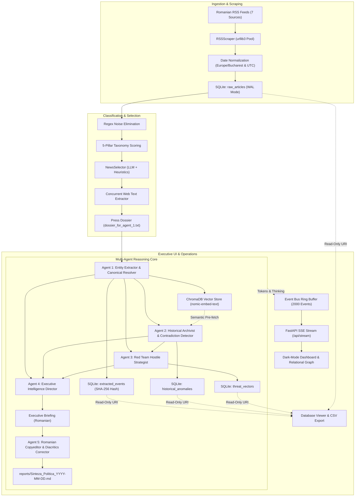

# Technical Architecture — OSINT Political Intelligence System

> **Status:** 🟩 Production Ready (Modernized Multi-Agent & SSE Streaming Architecture)  
> **Last Updated:** 2026-11-06  
> **Automated Verification:** 77/77 tests passing (100% pass rate)  

---

## Table of Contents

- [1. Executive System Shape](#1-executive-system-shape)
- [2. Subsystem Layer Architecture](#2-subsystem-layer-architecture)
- [3. Key Architectural Decisions & Invariants](#3-key-architectural-decisions--invariants)
- [4. End-to-End Data Flow Architecture](#4-end-to-end-data-flow-architecture)
- [5. Concurrency & Asynchronous Worker Model](#5-concurrency--asynchronous-worker-model)
- [6. Real-Time Streaming & Event Bus Architecture](#6-real-time-streaming--event-bus-architecture)
- [7. Verification & Automated Quality Gates](#7-verification--automated-quality-gates)
- [Appendix: Architectural Map](#appendix-architectural-map)

---

## 1. Executive System Shape

The Romanian OSINT Political Intelligence System is a fully decoupled, production-grade automated intelligence platform designed for Romanian national and geopolitical monitoring.



---

## 2. Subsystem Layer Architecture

The platform is strictly organized into decoupled, modular packages within `src/`:

### 1. Ingestion & Text Processing Layer (`src/scrapers/`, `src/utils_date.py`)
- **RSS Scraping:** Manages concurrent feed polling across 7 Romanian news sources using `requests.Session` with `HTTPAdapter` connection pooling (`pool_connections=10`, `pool_maxsize=20`) and exponential retry backoff.
- **DOM Extraction:** Uses BeautifulSoup to strip scripts, styles, iframes, and boilerplate while capturing semantic `<meta>` and `<time>` publication timestamps.
- **Date Normalization:** Dual-timezone anchoring (`Europe/Bucharest` calendar dates for daily bucketing and ISO-8601 UTC for chronological sorting), with explicit Romanian month word parsing and strict rejection of silent fallbacks to today's date.

### 2. Classification & Entity Normalization Layer (`src/classification/`)
- **5-Pillar Strategic Taxonomy:** Evaluates Domestic Politics (weight 1.5), Macroeconomy (1.4), National Security (1.5), Justice (1.3), and Critical Infrastructure (1.2) with 3x title keyword weighting.
- **Regex Noise Elimination:** Filters showbiz, reality TV, sports, horoscopes, and minor fender-benders while preserving articles containing critical national keywords.
- **Canonical Entity Resolver:** Maps colloquial names, nicknames, and Romanian political actors, parties, and institutions to standardized canonical identities.

### 3. Selection & Dossier Layer (`src/agents/selector.py`)
- **Two-Stage Filtering:** Combines taxonomic scoring with LLM candidate selection to identify the top 10 most consequential national developments.
- **Concurrent Deep Scraping:** Pulls full body text for selected candidates across 5 worker threads.
- **Dossier Compilation:** Compiles a dense, factual Romanian press summary dossier (`dossier_for_agent_1.txt`) formatting articles under `ȘTIREA [Number]:` with verbatim quotes.

### 4. Multi-Agent Reasoning Core (`src/agents/`)
- **Agent 1 (`EntityExtractorAgent`):** Structured extraction of political actions, English topic classifications, and verbatim Romanian quotes with deterministic SHA-256 `event_hash` deduplication.
- **Agent 2 (`ArchivistAgent`):** Vector search via ChromaDB paired with SQLite historical queries; detects political flip-flops and scores contradictions on a 0.0 to 1.0 scale.
- **Agent 3 (`RedTeamAgent`):** Adversarial strategic modeling identifying systemic vulnerabilities, opposition weaponization vectors, and parasitic narrative framing.
- **Agent 4 (`DirectorAgent`):** Synthesizes a formal 5-section executive briefing in Romanian, incorporating exactly 5 predictive forecasts with numerical confidence scores and volatility ratings.
- **Agent 5 (`CopyeditorAgent`):** Corrects Romanian typography, diacritics, and formatting, outputting the final briefing to `reports/Sinteza_Politica_YYYY-MM-DD.md`.

### 5. Storage & Vector Memory Layer (`src/storage/`)
- **SQLite Database (`political_intel.db`):** Configured in WAL mode (`PRAGMA journal_mode = WAL`) with foreign keys and composite indexes across dates, actors, run IDs, and event hashes. Includes a strict read-only connection pool (`?mode=ro`) for web endpoints.
- **ChromaDB Vector Store (`chroma_db/`):** Persistent vector store using local Ollama `nomic-embed-text` embeddings (768 dimensions) with batch embedding acceleration and semantic search.

### 6. Orchestration & Event Streaming Layer (`src/orchestrator/pipeline.py`, `src/events.py`)
- **MasterPipeline:** Manages stage transitions (`ingest`, `select`, `agents`, `synthesize`, `all`), run ID generation, and state machine persistence in `pipeline_executions`.
- **Event Bus:** In-memory ring buffer holding the last 2000 events with monotonic sequence numbering, `Last-Event-ID` replay support, and cooperative cancellation tokens (`is_cancelled()`).

### 7. Executive Web Dashboard Layer (`src/ui/`)
- **FastAPI Backend:** Non-blocking asynchronous REST API with background worker threading.
- **Real-Time SSE Stream:** Broadcasts live model thinking processes, content tokens, and log records.
- **Operations Dashboard:** Dark-slate defense UI with Marked.js report rendering, full read-only database viewer with CSV export, and D3.js force-directed Connected Papers relational graph.

---

## 3. Key Architectural Decisions & Invariants

| Architectural Invariant | Specification | Rationale |
|---|---|---|
| **Context Window Guarantee** | `num_ctx = 131072` | Enforced in `.env`, `src/config.py`, and `src/llm/client.py`. Prevents context truncation across extensive daily dossiers and multi-agent loops. |
| **Decoupled Embedding Model** | `nomic-embed-text` (dim=768) | Dedicated embedding model separate from generative LLM (`gemma-4-e4b`), avoiding VRAM contention and HTTP 500 endpoint errors. |
| **Local-First Privacy** | 100% On-Premises | Zero external cloud API calls; absolute data sovereignty and air-gapped capability. |
| **SQLite WAL Concurrency** | `PRAGMA journal_mode = WAL;` | Allows concurrent readers (web dashboard, DB viewer) while writer threads insert scraped articles or pipeline checkpoints. |
| **Read-Only Web Connections** | `file:path?mode=ro` | Web viewer queries use read-only SQLite connections, eliminating any possibility of web-induced data corruption. |
| **Deterministic Deduplication** | SHA-256 `event_hash` | Prevents duplicate event insertion into relational and vector stores across repeated pipeline runs. |
| **Cooperative Cancellation** | Threading cancellation token | Checkpoints between stages and loops enable safe, immediate pipeline halting without database corruption. |

---

## 4. End-to-End Data Flow Architecture

The end-to-end data flow operates through strictly typed Pydantic models:

```
[RSS Feeds]
    │
    ▼
RawArticle (source, title, link, summary, published_at, published_date)
    │
    ▼
ScrapedArticle (title, source, link, full_text, published_date)
    │
    ▼
dossier_for_agent_1.txt
    │
    ▼
ExtractedEvent (actor, canonical_actor, action, verbatim_evidence, topic, event_hash)
    ├───> SQLite: extracted_events
    └───> ChromaDB: nomic-embed-text vector embeddings
    │
    ▼
HistoricalAnomaly (anomaly_type, target, past_statement, current_statement, contradiction_score, analyst_note)
    │
    ▼
ThreatVector (threat_type, vulnerable_actor, exploiting_actor, description)
    │
    ▼
ExecutiveBriefing (date, raw_markdown, corrected_markdown, volatility_level)
    │
    ▼
Disk: reports/Sinteza_Politica_YYYY-MM-DD.md  <───>  Web Dashboard (FastAPI / SSE)
```

---

## 5. Concurrency & Asynchronous Worker Model

To prevent blocking the FastAPI ASGI event loop during long-running LLM inferences:
1. `PipelineStateManager` dispatches `MasterPipeline.run()` to a background daemon thread (`_execute_worker`).
2. An internal threading lock enforces mutual exclusion: only one pipeline run can execute at any given time, returning `HTTP 409 Conflict` if a concurrent run is requested.
3. The main thread continues serving HTTP requests, responding to health checks, and streaming events via SSE.

---

## 6. Real-Time Streaming & Event Bus Architecture

The `EventBus` implements a publisher-subscriber broker bridging synchronous agent threads with asynchronous FastAPI SSE endpoints:

```
[Agent Thread / OllamaClient]
           │
           ▼
    event_bus.publish(type, text, agent, run_id)
           │
           ├──────────────────────────────┐
           ▼                              ▼
[Lock-Protected deque]          [Asyncio Loop Dispatch]
 (Ring Buffer: 2000 events)      loop.call_soon_threadsafe(q.put_nowait, event)
           │                              │
           ▼                              ▼
  Last-Event-ID Replay          FastAPI SSE StreamingResponse (/api/stream)
                                          │
                                          ▼
                                Browser EventSource Client
```

---

## 7. Verification & Automated Quality Gates

The technical architecture is backed by an automated testing suite:
- **Total Automated Tests:** **77 tests passing** (`tests/unit/` and `tests/integration/`).
- **Pass Rate:** **100%**.
- **Execution Speed:** **~3.05 seconds** across the entire suite via `uv run pytest`.
- **Coverage Areas:** Multi-format date parsing, Romanian date regression, taxonomy scoring, noise elimination, entity resolution, event bus ring buffer, cooperative cancellation, LLM token cleaning, 131k context window preservation, SQLite WAL mode, deduplication, DB viewer APIs, CSV export, system purge, and ChromaDB vector operations.

---

## Appendix: Architectural Map

- [`src/config.py`](file:///d:/OSINT/src/config.py) — Central settings and 131k context window configuration
- [`src/events.py`](file:///d:/OSINT/src/events.py) — Thread-safe EventBus and SSE event serialization
- [`src/utils_date.py`](file:///d:/OSINT/src/utils_date.py) — Canonical timezone normalization and Romanian date parser
- [`src/scrapers/`](file:///d:/OSINT/src/scrapers/) — RSS feed scraper and HTML text extractor
- [`src/classification/`](file:///d:/OSINT/src/classification/) — 5-pillar taxonomy and canonical entity resolver
- [`src/agents/`](file:///d:/OSINT/src/agents/) — Selector and multi-agent reasoning ensemble
- [`src/storage/`](file:///d:/OSINT/src/storage/) — SQLite WAL manager and ChromaDB vector store
- [`src/orchestrator/`](file:///d:/OSINT/src/orchestrator/) — MasterPipeline execution engine and state machine
- [`src/ui/`](file:///d:/OSINT/src/ui/) — FastAPI web application, SSE broker, and dark-mode dashboard
- [`tests/`](file:///d:/OSINT/tests/) — 77-test automated unit and integration suite

---

_Generated by Kipi — Core-Knowledge Keeper_
