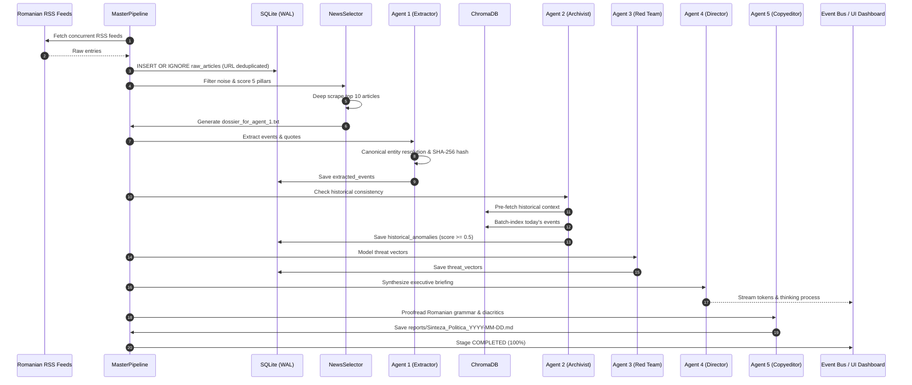

# Intelligence Pipeline End-to-End Execution Flow

> **Summary:** Step-by-step technical lifecycle of the intelligence workflow: Ingestion, Selection, Extraction, Contradiction Detection, Hostile Strategy Modeling, Executive Synthesis, Proofreading, and Real-Time SSE Streaming.

**Status:** 🟩 Stable  
**Owner role:** Lead Pipeline Engineer (link to [ownership-map.md](../team_and_stakeholders/ownership-map.md))  
**Last updated:** 2026-11-06  

---

## Table of Contents

- [Overview](#overview)
- [End-to-End Pipeline Sequence Diagram](#end-to-end-pipeline-sequence-diagram)
- [Step 1: Feed Ingestion & Normalization (`stage_ingest`)](#step-1-feed-ingestion--normalization-stage_ingest)
- [Step 2: Selection & Press Dossier Generation (`stage_select`)](#step-2-selection--press-dossier-generation-stage_select)
- [Step 3: Structured Entity Extraction (`stage_agents` — Agent 1)](#step-3-structured-entity-extraction-stage_agents--agent-1)
- [Step 4: Historical Contradiction Detection (`stage_agents` — Agent 2)](#step-4-historical-contradiction-detection-stage_agents--agent-2)
- [Step 5: Hostile Strategic Modeling (`stage_agents` — Agent 3)](#step-5-hostile-strategic-modeling-stage_agents--agent-3)
- [Step 6: Executive Intelligence Synthesis (`stage_synthesize` — Agent 4)](#step-6-executive-intelligence-synthesis-stage_synthesize--agent-4)
- [Step 7: Romanian Linguistic Proofreading (`stage_synthesize` — Agent 5)](#step-7-romanian-linguistic-proofreading-stage_synthesize--agent-5)
- [Step 8: Real-Time SSE Streaming & Dashboard Display](#step-8-real-time-sse-streaming--dashboard-display)
- [Artifact Lifecycle Matrix](#artifact-lifecycle-matrix)
- [Operational Notes](#operational-notes)
- [Appendix: Key Code Locations](#appendix-key-code-locations)

---

## Overview

The intelligence pipeline transforms raw, noisy public media feeds into an actionable, executive-level political intelligence briefing. The process executes across eight sequential steps governed by `MasterPipeline` ([`src/orchestrator/pipeline.py`](file:///d:/OSINT/src/orchestrator/pipeline.py)), with state tracking in SQLite and real-time streaming to the user interface.

---

## End-to-End Pipeline Sequence Diagram

---

## Step 1: Feed Ingestion & Normalization (`stage_ingest`)

1. **Trigger:** `MasterPipeline.stage_ingest(run_id)`.
2. **Action:**
   - `RSSScraper` queries configured feeds concurrently across a thread pool.
   - Extracts link, title, raw summary, and publication timestamps.
   - Cleans HTML boilerplate with `clean_html()`.
   - Normalizes timestamps into UTC (`published_at`) and calendar date in `Europe/Bucharest` (`published_date`).
3. **Storage:** Bulk-inserts articles into SQLite table `raw_articles` using `INSERT OR IGNORE` to discard duplicates.
4. **Events:** Emits `stage` event with `progress_pct: 25`.

---

## Step 2: Selection & Press Dossier Generation (`stage_select`)

1. **Trigger:** `MasterPipeline.stage_select(run_id, target_date)`.
2. **Action:**
   - Validates target date via `validate_target_date()`, rejecting future dates.
   - Queries `raw_articles` matching the target date.
   - Runs `IntelligenceTaxonomy.is_noise()` to drop reality TV, sports, and weather.
   - Scores articles across the 5 pillars, tagging articles scoring $>2.0$ as `[STRATEGIC SIGNAL]`.
   - Sends top 40 candidates to LLM with `SYSTEM_PROMPT_SELECTOR` to pick the 10 most critical national developments.
   - Dispatches `scrape_full_text()` across 5 worker threads to retrieve full article bodies.
   - Sends full texts to LLM with `SYSTEM_PROMPT_DOSSIER` to compile an objective, narrative summary dossier.
3. **Output:** Writes structured dossier to `dossier_for_agent_1.txt`.
4. **Events:** Emits `stage` event with `progress_pct: 50`.

---

## Step 3: Structured Entity Extraction (`stage_agents` — Agent 1)

1. **Trigger:** `EntityExtractorAgent.run(dossier_text)`.
2. **Action:**
   - Sends the dossier to Ollama with `SYSTEM_PROMPT_AGENT_1` using `generate_structured(..., response_model=ExtractedEventsContainer)`.
   - Extracts discrete political maneuvers, English action descriptions, and verbatim Romanian quotes.
   - Passes every actor through `EntityResolver.resolve_actor()`, mapping informal titles to canonical identities.
   - Computes deterministic SHA-256 hash:
     $$\text{hash} = \text{SHA256}(\text{canonical\_actor} \parallel \text{action} \parallel \text{verbatim\_evidence})$$
3. **Storage:** Inserts unique events into SQLite table `extracted_events`.
4. **Checkpoint:** Evaluates `event_bus.is_cancelled()`.
5. **Events:** Emits `stage` event with `progress_pct: 65`.

---

## Step 4: Historical Contradiction Detection (`stage_agents` — Agent 2)

1. **Trigger:** `ArchivistAgent.run(events)`.
2. **Phase A (Vector Pre-fetch):**
   - For each extracted event, queries ChromaDB for historical statements by the same canonical actor.
   - Falls back to SQLite historical records if vector store has no prior context.
   - After context pre-fetch is complete, batch-indexes today's events into ChromaDB using `nomic-embed-text` embeddings.
3. **Phase B (Inference & Filtering):**
   - Submits today's event and historical statements to LLM with `SYSTEM_PROMPT_AGENT_2`.
   - Analyzes whether today's claim contradicts past statements on a scale from `0.0` to `1.0`.
   - Applies `_is_spurious_anomaly()` to discard matches where statements repeat each other or analyst notes state consistency.
4. **Storage:** Inserts genuine contradictions ($\ge 0.5$) into SQLite table `historical_anomalies`.
5. **Checkpoint:** Evaluates `event_bus.is_cancelled()`.
6. **Events:** Emits `stage` event with `progress_pct: 70`.

---

## Step 5: Hostile Strategic Modeling (`stage_agents` — Agent 3)

1. **Trigger:** `RedTeamAgent.run(events, anomalies)`.
2. **Action:**
   - Feeds extracted events and anomalies into LLM with `SYSTEM_PROMPT_AGENT_3`.
   - Identifies vulnerable political figures, narrative exploitation vectors, and parasitic framing opportunities.
3. **Storage:** Inserts identified threat vectors into SQLite table `threat_vectors`.
4. **Checkpoint:** Evaluates `event_bus.is_cancelled()`.
5. **Events:** Emits `stage` event with `progress_pct: 75`.

---

## Step 6: Executive Intelligence Synthesis (`stage_synthesize` — Agent 4)

1. **Trigger:** `DirectorAgent.run(events, anomalies, threats, articles, target_date)`.
2. **Action:**
   - Cleans technical database keys and hashes from payload objects.
   - Formats the date in natural Romanian (e.g. `"6 Noiembrie 2026"`).
   - Generates the executive briefing adhering to the strict 5-section layout:
     * Section 1: TL;DR (3 sentences).
     * Section 2: Power dynamics and covert alliances.
     * Section 3: Black Swan tracking (social/infrastructure crises).
     * Section 4: Exactly 5 forward-looking predictions with numerical Confidence Scores (0–100%) and Volatility rating (`Scăzut`, `Mediu`, `Ridicat`).
     * Section 5: Tracked sources and methodology.
   - Cleans any leaked bracketed hex hashes.
3. **Checkpoint:** Evaluates `event_bus.is_cancelled()`.
4. **Events:** Emits `stage` event with `progress_pct: 90`.

---

## Step 7: Romanian Linguistic Proofreading (`stage_synthesize` — Agent 5)

1. **Trigger:** `CopyeditorAgent.run(raw_briefing, target_date)`.
2. **Action:**
   - Proofreads raw markdown against `SYSTEM_PROMPT_AGENT_5`.
   - Normalizes Romanian diacritics (`ă`, `â`, `î`, `ș`, `ț`), corrects typos, and preserves analytical content.
3. **Storage:** Saves the finalized report to `reports/Sinteza_Politica_YYYY-MM-DD.md`.
4. **State Update:** Updates SQLite `pipeline_executions` to `COMPLETED`.
5. **Events:** Emits `stage` event with `progress_pct: 100`.

---

## Step 8: Real-Time SSE Streaming & Dashboard Display

Throughout steps 1 through 7, all token emissions, thinking chunks, stage transitions, and log messages are broadcast simultaneously:
- **Event Bus:** Ring buffer holds events in memory.
- **Browser EventSource:** Receives structured JSON events at `/api/stream`.
- **UI Elements:**
  * Progress bar updates from 0% to 100%.
  * Live Token Stream renders markdown content incrementally.
  * Collapsible Thinking Drawer displays the model's internal reasoning.
  * Recent reports list refreshes upon completion.

---

## Artifact Lifecycle Matrix

| Stage | Input Artifact | Output Artifact | Persistent Destination |
|---|---|---|---|
| **Ingest** | RSS Feed URLs | List[`RawArticle`] | SQLite: `raw_articles` |
| **Select** | `raw_articles` | `dossier_for_agent_1.txt` | Workspace root |
| **Extract** | `dossier_for_agent_1.txt` | List[`ExtractedEvent`] | SQLite: `extracted_events` |
| **Archivist** | `ExtractedEvent` + History | List[`HistoricalAnomaly`] | SQLite: `historical_anomalies` + ChromaDB |
| **Red Team** | Events + Anomalies | List[`ThreatVector`] | SQLite: `threat_vectors` |
| **Director** | Multi-Agent Data | Raw Markdown Briefing | In-Memory String |
| **Copyeditor**| Raw Markdown Briefing | Polished Markdown Briefing | Disk: `reports/Sinteza_Politica_*.md` |

---

## Operational Notes

- **End-to-End Duration:** Typically completes in 2–4 minutes depending on GPU acceleration.
- **Cooperative Halt:** If cancellation is requested, execution halts immediately between any step, recording `status: CANCELLED` in SQLite.

---

## Appendix: Key Code Locations

- `src/orchestrator/pipeline.py` — MasterPipeline implementation
- `src/agents/selector.py` — NewsSelector implementation
- `src/agents/agent_extractor.py` — EntityExtractorAgent implementation
- `src/agents/agent_archivist.py` — ArchivistAgent implementation
- `src/agents/agent_red_team.py` — RedTeamAgent implementation
- `src/agents/agent_director.py` — DirectorAgent implementation
- `src/agents/agent_copyeditor.py` — CopyeditorAgent implementation
- `src/events.py` — EventBus implementation

---

_Generated by Kipi — Core-Knowledge Keeper_
